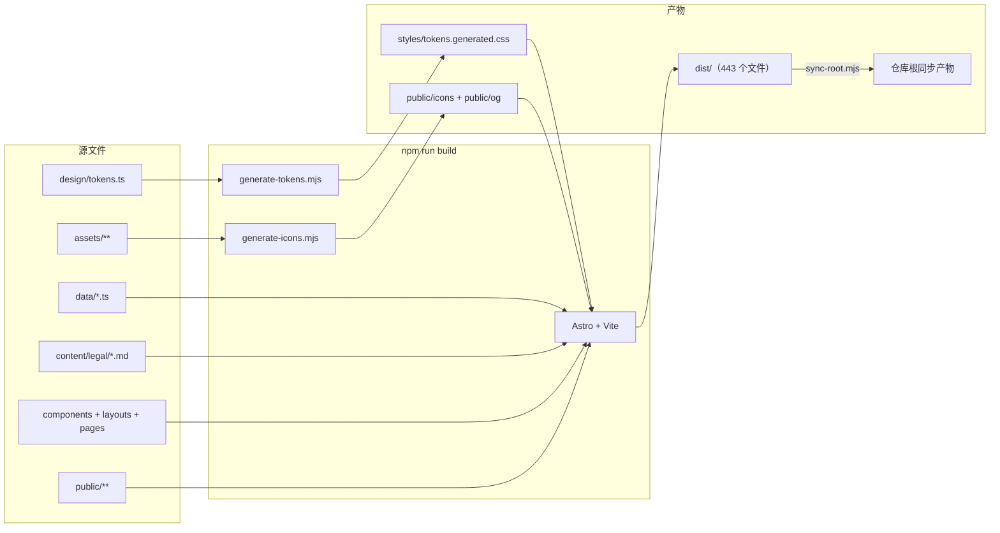

# 01 · 整体架构

## 1. 定位与系统边界

园枢官网是一个**静态展示型站点**：把 iOS 应用的产品信息、功能说明、真机截图、平台架构图、系统权限与隐私说明、法律文本呈现给访客。站点本身不是应用本体，也不承担业务逻辑。

```text
┌───────────────────────────── 构建期（Node.js） ─────────────────────────────┐
│  src/design/tokens.ts ──generate-tokens──▶ src/styles/tokens.generated.css   │
│  src/assets/brand/app-icon.png ──generate-icons──▶ public/icons, public/og   │
│  src/data/* + src/content/legal/* + src/components/* + src/layouts/*        │
│        └── Astro 7（Vite）渲染 ──▶ dist/（HTML + 哈希化 CSS/JS/图片）         │
│  dist/ ──sync-root──▶ 仓库根目录（双兼容发布产物）                            │
└──────────────────────────────────────────────────────────────────────────────┘
                                        │ git push main
                                        ▼
┌───────────────────────────── 运行期（浏览器） ──────────────────────────────┐
│  访客 ──HTTP──▶ 静态文件（HTML / CSS / JS / AVIF / WebP / PNG / JPG）       │
│  页面内容：构建期已确定                 交互状态：仅存在于浏览器内存          │
│  持久化：仅 localStorage['garden:theme']                                     │
│  外链：用户主动点击时前往工信部备案 / 公安备案查询                            │
└──────────────────────────────────────────────────────────────────────────────┘
```

**不在边界内**：iOS 应用源码、后端 API、数据库、账号体系、支付、统计上报、推送服务、服务端渲染、表单提交。页面中描述的应用能力（聚合、离线缓存、通知等）只是产品介绍内容。

由此形成三条架构事实：

1. 没有运行时数据层，只有「构建期内容层 + 样式层 + 少量交互层」；
2. 所有页面在构建期定型，运行期不依赖任何接口的可用性；
3. 内容变更必须改源码并重新发布，不存在后台编辑入口。

---

## 2. 技术选型

| 决策         | 实际选择                                                     | 目的 / 收益                                             | 代价                                              |
| ------------ | ------------------------------------------------------------ | ------------------------------------------------------- | ------------------------------------------------- |
| 站点生成     | Astro 7.4.2，`output` 默认静态，`build.format: 'file'`         | 组件复用、类型检查、资源优化，同时产出纯静态 HTML        | 引入 Node 构建步骤与依赖管理                      |
| 页面语言     | `.astro` 组件 + TypeScript                                   | 构建期渲染、零客户端框架、模板与逻辑同文件               | 需要学习 Astro 语法                               |
| 类型系统     | TypeScript 6.0.3，`astro/tsconfigs/strict` + 额外严格选项     | 数据契约、组件 Props、脚本 API 全部有类型               | 类型错误会阻塞构建                                |
| 样式         | 原生 CSS + 自定义属性，两层设计令牌                           | 无运行时 CSS-in-JS，主题切换只换变量                    | 需要维护令牌生成器与命名约定                      |
| 客户端行为   | 原生 TypeScript 模块，Vite 打包为单个入口                     | 无 React/Vue 运行时，交互代码体积小                     | 需要手写 DOM 操作与可访问性状态同步               |
| 图片         | `astro:assets` 的 `<Picture>` + sharp                         | 构建期生成 AVIF/WebP 多宽度派生图，自动 `srcset` / `sizes` | 构建时间与 `sharp` 原生依赖增加                   |
| 内容         | Astro Content Collections（`glob` loader + zod）              | 法律文本与代码分离，frontmatter 强校验                  | 内容结构受 schema 约束                            |
| 字体         | `@fontsource-variable/fraunces` 随包打包                      | 无远程字体请求、无 FOUT 外部依赖                        | 字体文件进入构建产物                              |
| 测试         | Vitest（单元）+ Playwright（E2E / axe / 视觉）                | 算法、交互、可访问性与像素回归均可自动判定              | 视觉基线依赖平台与浏览器版本                      |
| 部署         | EdgeOne Makers 静态托管，仓库根 + `dist/` 双兼容              | 推送即上线，无需运维                                    | 产物重复入库，仓库体积增大                        |

选型依据见 [ADR-0002](../docs/adr/0002-build-stack.md)、[ADR-0003](../docs/adr/0003-design-system.md)、[ADR-0005](../docs/adr/0005-runtime-and-state.md)、[ADR-0007](../docs/adr/0007-deployment.md)、[ADR-0011](../docs/adr/0011-release-sync.md)。

---

## 3. 总体架构

### 3.1 构建期管线



关键点：

- `generate-tokens.mjs` 直接导入 `src/design/tokens.ts`（依赖 Node 24 的原生 TypeScript 支持），生成只读 CSS；
- `generate-icons.mjs` 用 sharp 从单张应用图标派生 favicon、PWA 图标、Apple Touch Icon 与 OG 图；
- Astro 把 `.astro`、Markdown、数据模块与样式在构建期渲染为 HTML；图片经 sharp 转为 AVIF/WebP 多尺寸；
- 客户端 `<script>` 被 Vite 打包为哈希命名的 ES 模块；
- `sync-root.mjs` 把 `dist/` 中白名单条目复制到仓库根，并写入 `.release-manifest.json`。

### 3.2 分层职责

| 层         | 载体                                                                 | 职责                                                         | 关键约束                                             |
| ---------- | -------------------------------------------------------------------- | ------------------------------------------------------------ | ---------------------------------------------------- |
| 页面层     | `src/pages/*`                                                        | 路由与页面组装、静态路径生成、manifest 端点                  | 只做编排，不承载可复用逻辑                           |
| 布局层     | `src/layouts/BaseLayout.astro`、`LegalLayout.astro`                  | HTML 骨架、页头页脚、跳转链接、脚本入口、法律页排版          | 所有页面必须经布局输出                               |
| 组件层     | `src/components/**`                                                  | 区块与 UI 的结构、文案、图片渲染                              | 不直接操作 DOM；交互通过 `data-*` 契约交给脚本       |
| 内容层     | `src/data/*`、`src/content/legal/*`                                  | 站点常量、首页文案、截图/架构图索引、FAQ、法律文本           | 单一事实源；数量与顺序变更会影响测试                 |
| 设计系统层 | `src/design/tokens.ts`、`src/styles/*`                               | 令牌定义、生成物、基础/工具/组件/展示/编辑样式               | 组件内禁止硬编码颜色                                 |
| 行为层     | `src/scripts/*`、`src/lib/*`                                         | 轮播、灯箱、导航、主题、显现、目录、埋点                     | 渐进增强；无框架；尊重减弱动效                       |
| 构建脚本层 | `scripts/*.mjs`                                                      | 令牌、图标、对比度、发布同步、独立巡检                       | 失败必须非零退出，供 CI 门禁使用                     |
| 测试层     | `tests/unit/*`、`tests/e2e/*`                                        | 算法与数据契约、交互与可访问性、响应式、视觉回归             | 单元测试不依赖 DOM 环境以外的浏览器                  |
| 交付层     | `.github/workflows/ci.yml`、根目录产物、EdgeOne                     | CI 门禁、发布同步、静态分发                                  | 推送 `main` 即上线；根产物必须与 `dist/` 一致        |

### 3.3 页面级骨架

```text
BaseLayout
├── <head>
│   ├── inline theme-init（防主题闪烁）
│   └── <Seo>：title / description / canonical / OG / twitter / JSON-LD
├── <body id="top">
│   ├── a.skip-link → #main
│   ├── SiteHeader（桌面导航 + ThemeToggle + CTA + 移动端触发器）
│   ├── MobileNav（<dialog>，由脚本 showModal）
│   ├── <main id="main" tabindex="-1"> slot
│   ├── SiteFooter（导航 / 法律 / 联系方式 / 备案）
│   ├── ToTop
│   ├── Lightbox（全局单例 <dialog>）
│   └── <script> import '@/scripts/app'
```

法律页在 `main` 内使用 `LegalLayout`：左侧目录（`data-legal-toc`）+ 右侧文章（`data-legal-article`）。首页由 9 个组件与 1 个内联区块按固定顺序拼接：

```text
HeroSection → FactBand → AppInfoSection(#download) → IntroSection(#intro/#features)
→ ShowcaseSection(#screenshots) → ArchitectureSection(#architecture)
→ SystemSection(#system) → 内联 #updates(ReleaseTimeline preview)
→ FaqSection(#faq) → AboutSection(#about)
```

---

## 4. 构建期数据流

### 4.1 首页

```text
site.ts ───────────────┐
home.ts ───────────────┤
screenshots.ts ────────┤
architecture.ts ───────┼──▶ index.astro ──▶ Hero / FactBand / AppInfo / Intro / Showcase /
faq.ts ────────────────┤                    Architecture / System / updates / Faq / About
appStore.ts ───────────┤
appInfo.ts ────────────┤
releases.ts ───────────┤
schema.ts ─────────────┘                    └──▶ Seo（JSON-LD：WebSite + MobileApplication + FAQPage）
```

- `index.astro` 只负责组合组件与生成 JSON-LD 数组；
- 每个区块组件从数据模块读取内容，不接收重复文案；
- 截图与架构图用 `import` 引入 `ImageMetadata`，再由 `<Picture>` 输出多格式响应式图片；
- FAQ 同时驱动可见列表与 `faqSchema`，避免页面与结构化数据不一致。

### 4.2 法律页

```text
src/content/legal/*.md
  │ frontmatter: title、description、summary、effectiveDate、updatedDate、order
  ▼
content.config.ts（zod 校验）
  ▼
[slug].astro：getCollection('legal') → getStaticPaths()
  ├── render(entry) → <Content />
  └── 正则提取 H2 + GithubSlugger → headings
  ▼
LegalLayout：目录、日期、面包屑 JSON-LD、另一份法律文档与返回首页入口
```

- `getStaticPaths` 用 `entry.id` 作为 slug，输出路径为 `/${entry.id}.html`，刻意保留 `.html` 后缀以兼容 v1 旧链接；
- 目录锚点与正文 `h2[id]` 共用 `github-slugger` 算法（`rehype-slug` 同样基于它），并按出现顺序去重；
- 法律文本在构建期转为 HTML，客户端不再加载 Markdown 解析器。

### 4.3 派生资源

| 源                              | 生成器                  | 产物                                                                 | 消费方                                   |
| ------------------------------- | ----------------------- | -------------------------------------------------------------------- | ---------------------------------------- |
| `src/design/tokens.ts`          | `generate-tokens.mjs`   | `src/styles/tokens.generated.css`                                    | `global.css` 的第一层导入                |
| `src/assets/brand/app-icon.png` | `generate-icons.mjs`    | `public/icons/favicon-32.png`、`favicon.svg`、`icon-192/512.png`、`apple-touch-icon.png`、`public/og/og-default.png` | SEO、manifest、页头品牌图、关于区块       |
| `scripts/generate-og.mjs`       | 手工一次性运行          | `public/og/og-privacy.png`、`og-agreement.png`、`og-changelog.png` | 各页面独立 OG 图（`Seo` 按 `assets.ogImages` 选择） |
| `src/assets/screenshots/*.jpg`  | Astro + sharp           | `dist/_astro/*.avif`、`*.webp`、原格式多尺寸                         | Hero、轮播、缩略图、灯箱                  |
| `src/assets/architecture/*.png` | Astro + sharp           | 同上                                                                 | 架构图卡片与灯箱                          |
| `dist/**`                       | `sync-root.mjs`         | 仓库根同名产物 + `.release-manifest.json`                            | 静态托管平台                              |

---

## 5. 运行期行为架构

### 5.1 启动顺序

```text
HTML 解析
  ├── <head> 内联 theme-init：读取 localStorage、设置 data-theme / color-scheme、标记 .js
  ├── CSS 加载（令牌 + 各层样式）
  └── body 末尾模块脚本 app.ts
        ├── DOMContentLoaded（或立即，若已就绪）
        └── boot()
              ├── initAnalytics()        全局 data-track 委托
              ├── initThemeToggle()      三态按钮 + 系统主题监听
              ├── initMobileNav()        <dialog> 抽屉
              ├── initHeader()           滚动状态、当前区块、回到顶部
              ├── initHeroTilt()         Hero 设备框桌面微倾斜
              ├── initLightbox()         全局灯箱单例
              ├── initCarousel()         截图轮播（失败时兜底第一张）
              ├── initLegalToc()         法律页目录高亮
              └── initReveal()           IntersectionObserver 显现
```

### 5.2 状态模型

| 状态             | 存储位置                                | 生命周期         | 说明                                       |
| ---------------- | --------------------------------------- | ---------------- | ------------------------------------------ |
| 主题偏好         | `localStorage['garden:theme']`          | 跨会话           | `light` / `dark`；`system` 时删除键         |
| 当前轮播索引     | `ScreenshotCarousel.current`            | 页面会话         | 不持久化                                   |
| 灯箱当前组与索引 | `Lightbox.items` / `index`              | 打开期间         | 关闭后清空图片 `src` 与引用                |
| 导航展开状态     | `<dialog open>` + `body.is-locked`      | 打开期间         | 关闭时恢复焦点                             |
| 滚动显现状态     | 元素 `.is-visible`                      | 页面会话         | 触发后不再观察                             |
| 埋点事件         | `window.__gardenEvents`（最多 200 条）  | 页面会话         | 仅本地调试与 E2E 断言                      |
| 当前区块         | `aria-current="location"`               | 滚动期间         | 由 `initHeader` 计算                       |

### 5.3 渐进增强与降级

- **无 JavaScript**：页面内容、导航锚点、FAQ（原生 `<details>`）、法律页正文均可用；CSS 的 `prefers-color-scheme` 兜底深色；仅轮播、灯箱、主题按钮等增强功能不可用。
- **减弱动效**：`initReveal` 直接显示全部内容；`initHeader` 的回到顶部与缩略图滚动改为 `auto`；CSS 把过渡压缩到近乎 0。
- **轮播初始化失败**：`app.ts` 捕获异常，强制把第一张设为 `data-active="true"`，不阻塞其他模块。
- **存储不可用**：主题偏好读写均 `try/catch`，失败时只在当前会话生效。

---

## 6. 路由与页面信息架构

| 路由                 | 源文件                                                            | 输出                            | 说明                                             |
| -------------------- | ----------------------------------------------------------------- | ------------------------------- | ------------------------------------------------ |
| `/`                  | `src/pages/index.astro`                                           | `index.html`                    | 9 个组件 + 内联更新区块 + 三类 JSON-LD           |
| `/privacy.html`      | `src/pages/[slug].astro` + `src/content/legal/privacy.md`         | `privacy.html`                  | 9 个 H2 章节，含目录与打印样式                   |
| `/agreement.html`    | `src/pages/[slug].astro` + `src/content/legal/agreement.md`       | `agreement.html`                | 7 个 H2 章节                                     |
| `/changelog.html`    | `src/pages/changelog.astro`                                       | `changelog.html`                | 版本时间线 + WebSite / BreadcrumbList / ItemList |
| `/404.html`          | `src/pages/404.astro`                                             | `404.html`                      | `noindex`，四个出口                              |
| `/site.webmanifest`  | `src/pages/site.webmanifest.ts`                                   | `site.webmanifest`              | 静态端点，图标路径固定                           |
| `/sitemap-index.xml` | `@astrojs/sitemap`                                                | `sitemap-index.xml` + `sitemap-0.xml` | 过滤 `/404`，`changefreq: weekly`          |

首页信息架构：

```text
#top             Hero：品牌、定位、两个 CTA、首张截图、平台标签
（无 id）         FactBand：44 个本科专业 / 35 个机构 / 22 张界面 / 0 注册
#download        下载区：上架状态、应用信息 10 项、隐私摘要、更新日志入口
#intro           应用介绍：4 张卡片
#features        功能特性：6 张卡片，可跳转到对应截图
#screenshots     应用截图：22 张 iPhone 13 Pro Max（苍岭绿）轮播 + 缩略图轨 + 灯箱
#architecture    平台架构：10 张架构图 + 灯箱
#system          系统与隐私：4 组说明 + 官网隐私声明
#updates         最近更新：ReleaseTimeline 预览最近 3 条
#faq             常见问题：6 项（首项默认展开）
#about           关于我们：开发信息、联系方式、备案信息
```

导航由 `src/data/site.ts` 的 `navigation`（页内 6 项）、`legalNavigation`（两份法律文档）与 `resourceNavigation`（下载入口、更新日志）定义；页头与页脚在非首页把 `#anchor` 解析为 `/#anchor`，保证跨页锚点可用。

---

## 7. 横切关注点

### 7.1 SEO 与结构化数据

- 每页输出 `<title>`、`meta description`、`canonical`、Open Graph、Twitter Card；非首页标题自动追加 `· 园枢`；
- 首页输出 `WebSite`、`MobileApplication`、`FAQPage` 三类 JSON-LD；法律页输出 `WebSite` + `BreadcrumbList`；更新日志页输出 `WebSite` + `BreadcrumbList` + `ItemList`；
- `@astrojs/sitemap` 生成站点地图，`robots.txt` 指向 sitemap；
- 404 页面输出 `noindex, follow`，并从 sitemap 中排除。

### 7.2 主题与设计令牌

- 令牌分两层：原始色（ink / paper / gold / jade / blue / danger）与语义色（canvas / surface / text / accent / focus 等）；
- `tokens.ts` 是唯一事实源，`tokens.generated.css` 由脚本生成，禁止手改；
- 深色不是简单反色：独立定义语义色、阴影与 Hero 表面色，并经过 33 项 WCAG 对比度检查；
- 首屏主题在 `<head>` 内联脚本中提前应用，避免浅色闪屏；
- 组件样式只能使用 `var(--...)`，`check-tokens.mjs` 扫描 `src/` 中的十六进制、`rgb()`、`hsl()` 字面量。

### 7.3 可访问性

- 跳转链接、单一 `main`/`header`/`footer`/`h1`、语义化 section 与 `aria-labelledby`；
- 轮播与灯箱完整键盘支持（方向键、Home/End），缩略图使用 roving `tabindex`；
- 对话框使用原生 `<dialog>` + `showModal()`，关闭后恢复触发元素焦点；
- 动态状态通过 `role="status"`、`aria-live`、`aria-pressed`、`aria-current` 暴露；
- `prefers-reduced-motion` 全链路降级；焦点环、触控目标尺寸与对比度均有自动检查；
- 中文单语（`lang="zh-CN"`），不做 i18n/RTL（见 [ADR-0008](../docs/adr/0008-accessibility-and-i18n.md)）。

### 7.4 隐私与本地埋点

- 无 Cookie、无第三方请求、无身份信息；
- `track()` 把事件写入内存环形缓冲（上限 200）并派发 `CustomEvent('garden:event')`，供调试与 E2E 断言；
- `data-track` / `data-track-*` 在组件中声明，`initAnalytics` 统一委托监听，避免散落监听器。

### 7.5 性能

- 页面为静态 HTML，CSS 内联策略为 `inlineStylesheets: 'always'`（全量内联，消除首屏阻塞请求）；
- 图片由 `<Picture>` 输出 AVIF/WebP 多宽度，Hero 首图 `eager` + `fetchpriority="high"`，其余 `lazy`；
- 轮播预加载相邻两张；灯箱预加载下一张；
- `compressHTML: true`；prefetch 默认 `hover`，按需预取站内链接；
- 无客户端框架运行时，交互脚本只有一个入口。

### 7.6 上架状态与更新日志

两处「可切换状态」都收敛到数据层，页面组件基本只消费派生结果（例外：`HeroSection` 中一枚「即将上架 App Store」标签为静态文案，上架时需手动同步）：

| 状态源 | 位置 | 派生函数 / 字段 | 影响面 |
| --- | --- | --- | --- |
| App Store 上架状态 | `src/data/appStore.ts` | `hasDownloadUrl()`、`isAllowedAppStoreUrl()`、`appAvailability` | 下载区按钮/二维码、Hero 与 FAQ 文案、`apple-itunes-app`、`MobileApplication.offers.availability` |
| 版本记录 | `src/data/releases.ts` | `getRecentReleases()`、`getLatestReleasedRelease()`、`groupReleaseChanges()`、`releaseAnchor()` | 首页 `#updates`、`/changelog.html`、`appInfo.version/releaseDate`、`ItemList` JSON-LD |

安全约束：只有 `status === 'live'` 且 URL 为 `https://apps.apple.com/...` 时才渲染任何下载外链；未上架时不伪造发布日期与商店地址。

---

## 8. 发布架构

```text
开发者
  │ npm run release（build + sync-root + check）
  ▼
dist/ ────────────────┐
  │ sync-root          │ 白名单条目复制 + 清理旧产物
  ▼                    ▼
仓库根产物 ────────▶ git commit ──▶ git push main
                                      │
                                      ▼
                              EdgeOne Makers 静态托管
                               ├─ 若平台服务根目录：直接使用同步产物
                               └─ 若平台构建输出 dist：使用平台构建产物
```

- 双兼容策略解决「无法从代码侧确认平台输出目录」的问题，避免推送后 404；
- `.release-manifest.json` 记录 443 个文件，`--check` 按体积与清单比对，CI 与 `verify` 会拦截「改了源码但忘记同步」；
- 缓存策略建议：`_astro/*` 长缓存 immutable，HTML 短缓存，图标/OG 一天，manifest/sitemap 一小时（详见 [05](05-run-and-deploy.md)）。

---

## 9. 架构约束与非目标

**约束**：

1. 页面内容必须在构建期确定，禁止引入运行时数据请求；
2. 所有颜色必须来自设计令牌，禁止在 `src/` 中硬编码；
3. 交互脚本必须渐进增强，且尊重 `prefers-reduced-motion`；
4. 法律页 URL 必须保留 `.html` 后缀，保证旧链接不失效；
5. 根目录产物必须与 `dist/` 一致，发布前必须通过 `check:release`；
6. 依赖版本使用精确锁定（`--save-exact`），升级需全量跑 `verify`。

**非目标**（见 [ADR-0010](../docs/adr/0010-known-limitations.md)）：

- 不做 i18n / RTL、不做登录与表单、不做支付、不做后端 API；
- 不引入前端框架或客户端状态库；
- 不做 Service Worker / 离线访问；
- 不接入第三方统计、客服、广告或监控；
- 不做灰度发布与服务端监控，回滚依赖 Git 与发布目录。

---

## 10. 演进与扩展点

| 需求                       | 推荐落点                                                                 | 影响面                                               |
| -------------------------- | ------------------------------------------------------------------------ | ---------------------------------------------------- |
| 新增首页区块               | `src/components/home/` 新组件 + `index.astro` 组合 + 导航数据            | 样式层、导航、E2E、视觉基线                           |
| 新增法律文档               | `src/content/legal/*.md` + schema 已支持，`getStaticPaths` 自动生成       | 法律导航、E2E 章节数                                 |
| 新增截图 / 架构图          | `src/assets/` + `src/data/*`                                              | 数量断言、OG 文案、视觉基线                          |
| 新增主题色 / 换肤          | `src/design/tokens.ts` → `tokens:build` → 对比度门禁                     | 全部组件外观、视觉基线                               |
| 新增交互                   | `src/scripts/` 模块 + `app.ts` 启动 + `data-*` 契约                       | 可访问性、减弱动效、E2E                              |
| 更换部署平台               | 调整 `sync-root.mjs` 白名单 / 关闭同步，或改 CI 发布步骤                  | 仓库体积、发布文档                                   |
| 引入第二语言               | 需先修订 ADR-0008，再改路由、布局、内容集合与 SEO                        | 全站                                                 |

变更前请先阅读 [03 · 关键代码说明](03-key-code.md) 中的 DOM 契约与状态机，避免脚本与组件结构失配。
