# 04 · 依赖关系

本文件区分三类依赖：**运行时依赖**（进入浏览器）、**构建/开发依赖**（只在 Node 侧执行）、**内部模块依赖**（仓库内文件之间）。理解这三层可以快速判断「改一个包会不会影响线上」。

---

## 1. 运行时依赖

站点运行期只有仓库自身打出的 HTML/CSS/JS 与图片；**没有第三方运行时库、没有远程字体、没有统计或客服脚本**。

| 运行期资源           | 来源                                          | 加载方式                                       |
| -------------------- | --------------------------------------------- | ---------------------------------------------- |
| 页面 HTML            | Astro 构建期生成                              | 直接请求                                       |
| 样式                 | `src/styles/*` 经 Vite 打包                   | `/_astro/*.css`，`inlineStylesheets: 'auto'`    |
| 交互脚本             | `src/scripts/app.ts` 及其导入模块             | `/_astro/*.js`，`type="module"`                |
| 字体                 | `@fontsource-variable/fraunces` npm 包        | CSS `@import` 后被 Vite 打包为本地字体文件      |
| 图片                 | `src/assets/**` 经 sharp 派生                  | `dist/_astro/*.avif`、`*.webp`、原格式多尺寸     |
| 图标 / OG / 备案徽标 | `public/**` 与 `generate-icons.mjs` 产物       | 固定路径直接请求                               |

> 「0 第三方运行时依赖」指的是**不向第三方域名发请求**；字体包本身是 npm 构建依赖，但产物本地化。

---

## 2. 生产依赖（`dependencies`）

| 包                          | 版本    | 用途                                                                 | 影响范围                                       |
| --------------------------- | ------- | -------------------------------------------------------------------- | ---------------------------------------------- |
| `astro`                     | 7.4.2   | 静态站点生成、路由、组件、内容集合、图片管线                         | 全站构建；升级需全量回归                       |
| `@astrojs/sitemap`          | 3.7.4   | 生成 `sitemap-index.xml` / `sitemap-0.xml`，过滤 404                  | 路由与 SEO                                     |
| `@astrojs/markdown-remark`  | 7.3.4   | 提供 unified 处理器，挂载 `rehype-slug` / `rehype-autolink-headings` | 法律页标题 id 与锚点                           |
| `rehype-slug`               | 6.0.0   | 给 Markdown 标题加 `id`                                              | 法律页目录锚点                                 |
| `rehype-autolink-headings`  | 7.1.0   | 标题末尾追加 `#` 锚点链接                                            | 法律页阅读体验                                 |
| `github-slugger`            | 2.0.0   | 在 `[slug].astro` 中生成与 rehype 一致的 slug                        | 目录锚点；与 rehype-slug 版本必须协同          |
| `sharp`                     | 0.35.5  | Astro 图片服务、图标与 OG 图生成                                     | 构建期原生二进制；跨平台安装需匹配             |
| `@fontsource-variable/fraunces` | 5.3.0 | 可变衬线字体（OFL-1.1），本地打包                                     | 展示标题字体；无远程请求                       |

---

## 3. 开发依赖（`devDependencies`）

| 包                       | 版本    | 用途                                                     |
| ------------------------ | ------- | -------------------------------------------------------- |
| `@astrojs/check`         | 0.9.12  | `astro check` 类型检查                                   |
| `typescript`             | 6.0.3   | 类型系统与 `tsc` 行为                                    |
| `vitest`                 | 5.0.5   | 单元测试                                                 |
| `@playwright/test`       | 1.64.1  | E2E、响应式、视觉回归                                    |
| `@axe-core/playwright`   | 4.14.0  | 可访问性扫描                                             |
| `eslint`                 | 10.13.0 | JS/TS/Astro 静态检查                                     |
| `typescript-eslint`      | 8.72.0  | TypeScript 规则                                          |
| `eslint-plugin-astro`    | 3.2.1   | `.astro` 文件规则                                        |
| `@eslint/js`             | 10.0.1  | ESLint 推荐规则集                                        |
| `globals`                | 17.13.0 | 浏览器 / Node 全局变量声明                               |
| `prettier`               | 3.9.10  | 格式化                                                   |
| `prettier-plugin-astro`  | 1.1.1   | `.astro` 格式化                                          |
| `culori`                 | 4.0.2   | `check-contrast.mjs` 的 WCAG 对比度计算                   |
| `@types/node`            | 26.6.5  | Node API 类型（脚本、配置）                              |

依赖全部以精确版本写入 `package.json`（无 `^` / `~`），并由 `package-lock.json` 锁定传递依赖。升级策略见 [06 · 维护指南](06-maintenance.md#9-依赖升级)。

---

## 4. 内部依赖图

```mermaid
flowchart TD
    subgraph Content["数据与内容"]
        SITE["data/site.ts"]
        HOME["data/home.ts"]
        SHOTS["data/screenshots.ts"]
        ARCH["data/architecture.ts"]
        FAQ["data/faq.ts"]
        TYPES["data/types.ts"]
        LEGAL["content/legal/*.md"]
    end

    subgraph Design["设计系统"]
        TOKENS["design/tokens.ts"]
        CSS["styles/*"]
    end

    subgraph Logic["布局与库"]
        SEO["components/seo/Seo.astro"]
        SCHEMA["lib/schema.ts"]
        THEME["lib/theme.ts"]
        ANALYTICS["lib/analytics.ts"]
        FORMAT["lib/format.ts"]
        BASE["layouts/BaseLayout.astro"]
        LEGALLAYOUT["layouts/LegalLayout.astro"]
    end

    subgraph UI["组件"]
        CHROME["components/chrome/*"]
        HOMEC["components/home/*"]
        UIC["components/ui/*"]
    end

    subgraph Pages["页面"]
        INDEX["pages/index.astro"]
        SLUG["pages/[slug].astro"]
        P404["pages/404.astro"]
        MANIFEST["pages/site.webmanifest.ts"]
    end

    subgraph Runtime["运行时脚本"]
        APP["scripts/app.ts"]
        CAROUSEL["scripts/carousel.ts"]
        LIGHTBOX["scripts/lightbox.ts"]
        HEADER["scripts/header.ts"]
        NAV["scripts/mobile-nav.ts"]
        REVEAL["scripts/reveal.ts"]
        TOC["scripts/legal-toc.ts"]
    end

    TOKENS --> SITE
    TOKENS --> THEME
    TOKENS --> MANIFEST
    SITE --> SEO
    SITE --> SCHEMA
    SITE --> CHROME
    SITE --> MANIFEST
    TYPES --> HOME
    TYPES --> SHOTS
    TYPES --> ARCH
    HOME --> HOMEC
    SHOTS --> HOMEC
    ARCH --> HOMEC
    FAQ --> INDEX
    SCHEMA --> INDEX
    SCHEMA --> LEGALLAYOUT
    FORMAT --> LEGALLAYOUT
    SEO --> BASE
    CHROME --> BASE
    UIC --> BASE
    BASE --> INDEX
    BASE --> P404
    BASE --> LEGALLAYOUT
    LEGAL --> SLUG
    SLUG --> LEGALLAYOUT
    ANALYTICS --> CAROUSEL
    ANALYTICS --> LIGHTBOX
    THEME --> APP
    APP --> CAROUSEL
    APP --> LIGHTBOX
    APP --> HEADER
    APP --> NAV
    APP --> REVEAL
    APP --> TOC
    BASE --> CSS
```

补充说明：

- `data/site.ts` 只依赖 `design/tokens.ts` 的 `metaColors`，是唯一被「数据 → 设计」反向引用的点；
- `lib/schema.ts` 依赖 `data/site.ts`，被首页与法律布局共同使用；
- `scripts/*` 不相互导入，统一由 `app.ts` 组合，便于单独测试纯函数；
- 组件不直接导入具体交互模块（仅 `SiteHeader` 与 `BaseLayout` 声明入口 `app.ts`），行为与结构通过 DOM 契约解耦。

---

## 5. 路径别名

`tsconfig.json`、`vitest.config.ts` 与 Astro/Vite 共同使用 `@` 前缀：

| 别名            | 映射               | 典型使用                                   |
| --------------- | ------------------ | ------------------------------------------ |
| `@/*`           | `src/*`            | 通用导入                                   |
| `@components/*` | `src/components/*` | 模板中可选（多数使用 `@/components`）      |
| `@lib/*`        | `src/lib/*`        | 可选                                       |
| `@data/*`       | `src/data/*`       | 可选                                       |
| `@design/*`     | `src/design/*`     | 可选                                       |

`vitest.config.ts` 单独声明了 `@` → `src`，因此单元测试可以导入 `@/scripts/carousel` 与 `@/data/*`，但不会加载 `.astro` 文件。

---

## 6. 资源与产物依赖

| 产物                                   | 由谁生成                     | 被谁消费                                                       |
| -------------------------------------- | ---------------------------- | -------------------------------------------------------------- |
| `src/styles/tokens.generated.css`      | `generate-tokens.mjs`        | `src/styles/global.css` 第一层导入                              |
| `public/icons/favicon-32.png`          | `generate-icons.mjs`         | `Seo.astro` 的 `<link rel="icon">`                              |
| `public/icons/favicon.svg`              | `generate-icons.mjs`         | `Seo.astro` 的 SVG favicon                                     |
| `public/icons/apple-touch-icon.png`    | `generate-icons.mjs`         | `Seo.astro` 与 manifest                                        |
| `public/icons/icon-192.png` / `512`    | `generate-icons.mjs`         | `site.webmanifest`、页头与页脚的品牌图                          |
| `public/og/og-default.png`             | `generate-icons.mjs`         | OG / Twitter / `assets.ogImage` / schema 的 `image`             |
| `public/beian/beian.png`               | 手工提供                     | 页脚公安备案徽标                                               |
| `dist/_astro/*`                        | Astro + sharp                | HTML 中的 CSS/JS/图片引用                                      |
| `sitemap-index.xml` / `sitemap-0.xml`  | `@astrojs/sitemap`           | 搜索引擎；`robots.txt` 指向 index                              |
| 仓库根同名产物                         | `sync-root.mjs`              | 静态托管平台                                                   |
| `.release-manifest.json`               | `sync-root.mjs`              | `sync-root --check`、CI、发布审计                              |

---

## 7. 外部链接与网络边界

| 类型         | 目标                                                                 | 出现位置                          | 安全属性                     |
| ------------ | -------------------------------------------------------------------- | --------------------------------- | ---------------------------- |
| ICP 备案     | `https://beian.miit.gov.cn/`                                         | 页脚、关于区块                    | `target="_blank"` + `noopener noreferrer` |
| 公安备案查询 | `https://beian.mps.gov.cn/#/query/webSearch?code=14010602111139`     | 页脚、关于区块                    | 同上                         |
| 邮件         | `mailto:56967916@qq.com` / `mailto:uull@aliyun.com`                  | 页脚、关于区块、法律页联系声明    | 无                           |
| 结构化数据   | `https://jl.43322.cn/...`                                            | JSON-LD 的 `url` / `item` / `image` | 仅数据，不发请求             |
| Universal Links | `public/.well-known/apple-app-site-association` 中的 `appID`     | 静态文件                          | 由系统处理                   |

**运行时无其他外部请求**：E2E 的「页面加载阶段不请求第三方域名」用例会拦截并断言除 `127.0.0.1` / `localhost` 外无请求。

---

## 8. 浏览器 API 依赖

| API                                  | 使用位置                       | 缺失时的降级                                     |
| ------------------------------------ | ------------------------------ | ------------------------------------------------ |
| `localStorage`                       | 主题偏好                       | try/catch，仅在当前会话生效                      |
| `matchMedia`                         | 主题、减弱动效、桌面断点       | 主题按浅色；显现直接显示；抽屉断点监听不生效     |
| `IntersectionObserver`               | 显现动画、法律页目录           | 内容直接显示；目录仍可点击但不滚动高亮           |
| `<dialog>` + `showModal`             | 移动导航、灯箱                 | 原生焦点陷阱与 Esc；脚本仅在支持时初始化          |
| `CustomEvent`                        | 埋点与主题事件                 | 无替代；不影响页面内容                           |
| `requestAnimationFrame`              | 滚动节流                       | 现代浏览器均支持                                 |
| Pointer Events / `setPointerCapture` | 轮播滑动                       | 捕获失败时仍可在 `pointerup` 判定                |
| `HTMLImageElement.decode()`          | 灯箱                           | 可选链调用；失败转入错误态                       |
| `window.scrollTo` / `scrollIntoView` | 回到顶部、缩略图居中           | 立即跳转仍可用                                   |
| `Intl.DateTimeFormat`                | 构建期日期格式化               | 构建环境需完整 ICU（Node 官方构建满足）          |

站点不依赖 `fetch`、`XMLHttpRequest`、Cookie、IndexedDB 或 Service Worker。

---

## 9. 构建与 CI 环境依赖

| 项                 | 要求 / 版本                              | 说明                                                         |
| ------------------ | ---------------------------------------- | ------------------------------------------------------------ |
| Node.js            | ≥ 22（`engines`）                        | `generate-tokens.mjs` 直接导入 `.ts`，依赖原生类型剥离        |
| npm                | 随 Node 22                               | CI 使用 `npm ci` 严格安装                                     |
| 操作系统（本地）   | macOS / Linux                            | `sharp` 需对应平台原生二进制                                  |
| 浏览器（测试）     | Playwright Chromium                      | 视觉基线在 macOS 生成，文件名带 `-darwin`                     |
| CI 门禁任务        | `ubuntu-latest`，Node 22                 | 令牌、对比度、类型、Lint、格式、单测、构建、E2E（非视觉）      |
| CI 视觉任务        | `macos-latest`，Node 22                  | 仅跑 `@visual`，避免跨平台字体渲染差异                        |
| GitHub Actions     | `checkout@v4`、`setup-node@v4`、`upload-artifact@v4` | 见 [.github/workflows/ci.yml](../.github/workflows/ci.yml) |

---

## 10. 依赖风险与缓解

| 风险                                             | 触发条件                          | 缓解                                                                 |
| ------------------------------------------------ | --------------------------------- | -------------------------------------------------------------------- |
| Astro / 插件主版本升级破坏构建                   | 手工升级 `astro` / `@astrojs/*`   | 版本精确锁定；升级后跑完整 `verify`；保留 lockfile 回退               |
| `sharp` 原生二进制与平台不匹配                   | 换机器/换 CI 镜像                 | `npm ci` 重装；CI 与本地均使用受支持平台                              |
| `github-slugger` 与 `rehype-slug` 算法分叉       | 单独升级其一                      | 两者均锁定版本；法律页 E2E 校验目录锚点                              |
| 视觉基线跨平台漂移                               | 升级 Chromium、系统字体变化       | 基线文件名带平台后缀；仅在 macOS 生成/更新                           |
| Node < 22 无法运行脚本                           | 低版本 Node                       | `engines` 声明；README 与 wiki 明确要求                              |
| 字体许可变化                                     | Fraunces 上游协议调整             | OFL-1.1 允许分发；必要时回退系统衬线栈                               |
| 仓库体积过大                                     | 根目录产物 + 视觉基线入库         | `.release-manifest.json` 可审计；评估发布分支/外部存储（已知问题 P1-01、P2-04） |
| 供应链风险                                       | 新增依赖                          | 精确版本 + `npm audit --audit-level=high`（CI 继续执行但不阻塞）      |

依赖漏洞扫描当前记录为 0 个 high 及以上问题（见 `docs/acceptance/verification-report.md`），但该结果只代表扫描时点。
