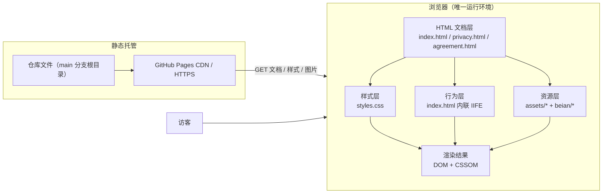
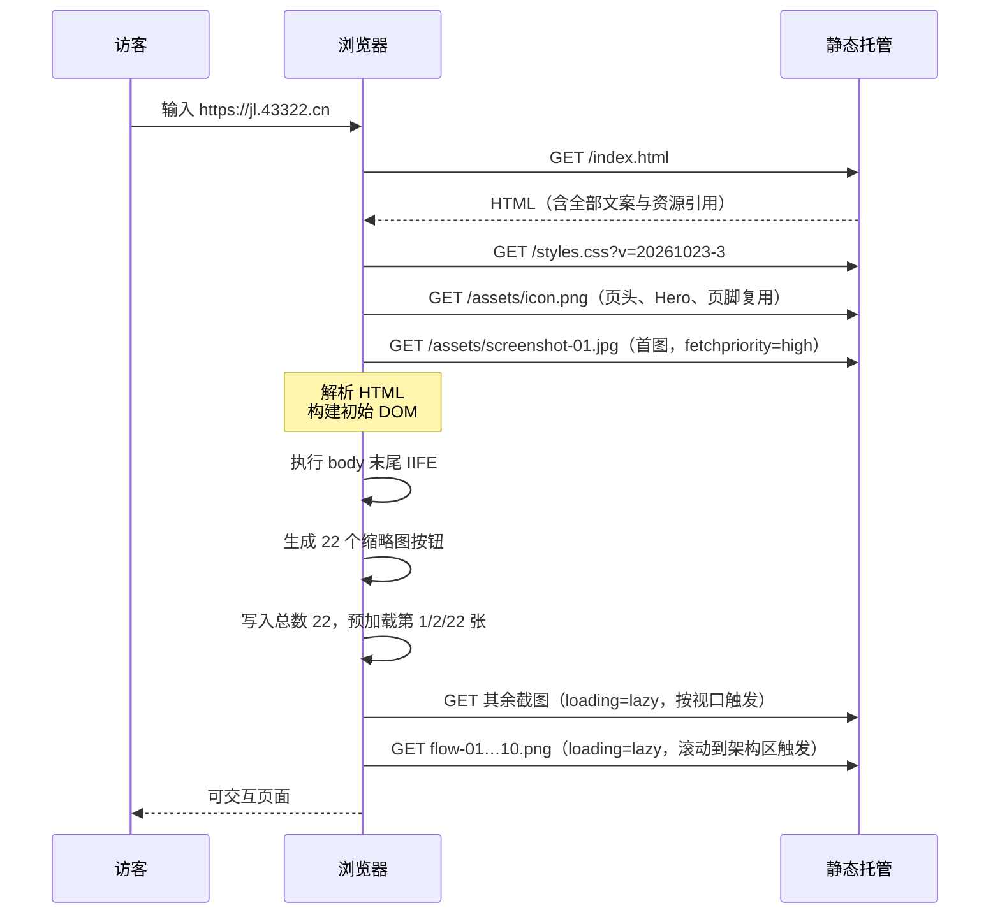
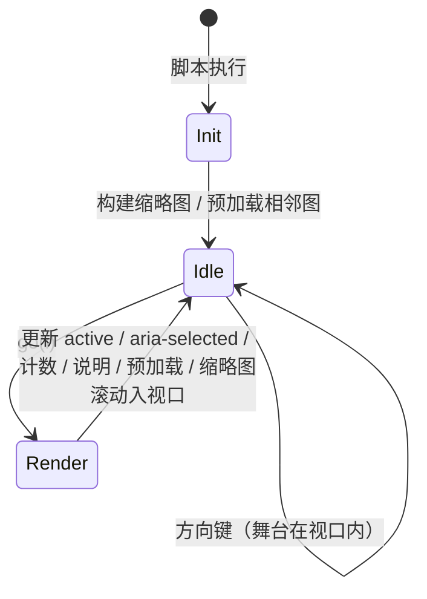

# 01 · 整体架构

## 1. 定位与系统边界

园枢官网是一个**展示型静态站点**，职责是把 iOS 应用的产品信息、功能说明、运行截图、平台架构图、系统权限与隐私说明、法律文本呈现给访客。

```text
┌────────────────────────── 系统边界 ──────────────────────────┐
│                                                              │
│   访客浏览器  ──HTTP──▶  静态文件（HTML / CSS / JS / 图片）    │
│                                                              │
│   页面内容：硬编码在 HTML 中                                  │
│   交互状态：仅存在于浏览器内存（轮播当前索引）               │
│   持久化：无 Cookie / LocalStorage / IndexedDB / 服务端       │
│                                                              │
└──────────────────────────────────────────────────────────────┘
        │
        └── 用户主动点击外链 ──▶ 工信部备案系统 / 公安备案查询
```

**不在边界内**：iOS 应用源码、任何 API、服务端渲染、数据库、账号体系、支付、统计、推送。页面中提到的应用能力（信息聚合、通知、缓存等）只是图文介绍。

系统边界决定了三个重要事实：

1. 没有「数据层」，只有「文档层 + 样式层 + 少量交互层」；
2. 没有构建产物，仓库文件即线上文件；
3. 所有内容变更都必须改源码，不存在后台编辑入口。

---

## 2. 技术选型

| 决策        | 实际选择                                                     | 目的 / 收益                        | 代价                                 |
| ----------- | ------------------------------------------------------------ | ---------------------------------- | ------------------------------------ |
| 页面技术    | 原生 HTML5                                                   | 零构建、可读性高、部署即生效       | 三个页面重复维护公共头尾             |
| 样式技术    | 单文件原生 CSS + CSS 自定义属性                              | 全站统一设计系统，改令牌即可换肤   | 文件随需求增长，选择器靠命名约定隔离 |
| 脚本技术    | 原生 JS，IIFE + ES5 语法风格（`padStart` 等少量 ES2017 API） | 兼容性稳妥、无框架体积、作用域隔离 | 无模块化、无类型检查、无单元测试     |
| 图标 / 装饰 | 内联 SVG（箭头）                                             | 无额外请求、可随文字颜色变化       | SVG 路径直接写在 HTML 中             |
| 图片        | JPG（截图）+ PNG（架构图/图标）                              | 素材来源统一、画质稳定             | 体积偏大，无 WebP/AVIF、无 `srcset`  |
| 字体        | 系统字体栈（宋体 / 苹方等）                                  | 零远程字体请求、首屏无字体闪烁     | 跨平台字形略有差异                   |
| 部署        | 静态托管（GitHub Pages）                                     | 零运维、HTTPS、自定义域            | 无服务端能力、依赖 Git 推送发布      |
| 依赖管理    | 无包管理器                                                   | 无供应链风险、无安装步骤           | 无法复用第三方组件，需自行实现       |

**为什么可行**：站点只有 3 个页面、1 个交互组件、34 个静态资源；内容更新频率低于代码更新频率，静态方案的总成本最低。

---

## 3. 总体架构



### 3.1 分层职责

| 层     | 载体                                      | 职责                                                  | 关键约束                                       |
| ------ | ----------------------------------------- | ----------------------------------------------------- | ---------------------------------------------- |
| 文档层 | 3 个 `.html`                              | 语义结构、内容、SEO 元信息、无障碍属性、轮播 DOM 契约 | 内容硬编码；公共头尾三页各存一份               |
| 样式层 | [styles.css](../../styles.css)               | 设计令牌、布局、组件外观、响应式、减弱动效            | 全站唯一入口；不引入外部样式                   |
| 行为层 | [index.html](../../index.html) 第 415–503 行 | 截图轮播：缩略图生成、切换、预加载、手势与键盘        | 仅首页；无框架；无持久化                       |
| 资源层 | `assets/`、`beian/`                       | 图标、截图、架构图、备案徽标                          | 本地相对路径；文件名与数量被文案和脚本隐式依赖 |
| 交付层 | Git + GitHub Pages                        | 版本管理、静态分发、自定义域、HTTPS                   | 推送即发布；无构建流水线                       |

### 3.2 页面级架构

三个页面共享同一套「页头 + 内容 + 页脚」外壳，但**没有模板引擎**，公共结构由复制粘贴维护：

```text
┌──────────────────────────────────────────────────────┐
│ site-header（sticky）：品牌 + 7 个导航链接            │  三页一致（链接前缀不同）
├──────────────────────────────────────────────────────┤
│ index.html                                           │
│   hero → intro → features → screenshots              │
│   → architecture → system → about                    │
│                                                      │
│ privacy.html / agreement.html                        │
│   main > .doc-wrap（标题、日期、章节 h2、列表）       │
├──────────────────────────────────────────────────────┤
│ site-footer：品牌 / 法律信息 / 联系方式 / 备案与版权   │  结构一致（版权与欢迎语有差异）
└──────────────────────────────────────────────────────┘
```

- 首页导航使用页内锚点（`#features` 等）；文档页导航使用跨页锚点（`index.html#features` 等）。
- 文档页无脚本，只有 `.doc-wrap` 排版样式。

---

## 4. 页面信息架构

```text
首页 index.html
├── #top           Hero：应用名、定位、简介、两个 CTA、版本说明
├── #intro         应用介绍：4 张卡片（是什么 / 解决什么 / 给谁用 / 隐私）
├── #features      功能特性：6 张卡片（01–06）
├── #screenshots   应用截图：22 张轮播（舞台 + 箭头 + 说明 + 缩略图）
├── #architecture  平台架构：10 张图（FIG 1/10 – FIG 10/10）
├── #system        系统与隐私：4 张卡片（运行环境 / 权限 / 网络 / 存储）
├── #about         关于我们：主体、版权、联系方式表
├── footer         法律链接、联系邮箱、ICP/公安备案、域名
└── script         轮播 IIFE

隐私政策 privacy.html
├── 一、引言
├── 二、我们收集的信息（本地数据清单）
├── 三、信息的使用目的
├── 四、系统权限说明（Face ID / 相册写入 / 通知）
├── 五、信息是否共享给第三方
├── 六、您的权利：数据如何删除
├── 七、未成年人条款
├── 八、隐私政策的更新
└── 九、联系我们

用户协议 agreement.html
├── 一、服务内容
├── 二、用户行为规范
├── 三、知识产权
├── 四、免责与责任限制
├── 五、协议变更
├── 六、争议解决
└── 七、联系我们
```

导航链接都指向存在的目标；其中 `#intro` 与 `#system` 未出现在导航中，但仍是有效锚点。`[id] { scroll-margin-top: 86px; }` 用于抵消吸顶导航高度，窄屏提升到 150/180px（[styles.css](../../styles.css) 第 60、884、888 行）。

---

## 5. 运行时数据流

### 5.1 首屏加载时序



**没有请求的参数化数据接口，也没有客户端模板渲染**。页面在网络传输完成后即完整，脚本只改变既有 DOM 的 class 与文本。

### 5.2 轮播状态流



状态只有一个整数 `cur`（当前索引）和缓存表 `preloaded`；无历史栈、无自动播放定时器、无 URL 同步。

### 5.3 交互数据来源

| 数据       | 来源                                           | 写入点                        |
| ---------- | ---------------------------------------------- | ----------------------------- |
| 截图路径   | ``              | HTML 硬编码                   |
| 缩略图     | 脚本读取 `.cvr-img` 的 `src` 与 `alt` 动态生成 | `rail.innerHTML`              |
| 截图说明   | 每张图的 `data-cap`                            | `go()` 写入 `#cvrCaption`     |
| 序号       | `cur + 1` 补零                                 | `#cvrCount`                   |
| 总数       | DOM 中 `.cvr-img` 数量                         | 初始化写入 `#cvrTotal`        |
| 无障碍标签 | `alt` 拼接                                     | 缩略图 `aria-label` / `title` |

---

## 6. 样式架构

[styles.css](../../styles.css) 采用「令牌 → 基础 → 组件 → 响应式 → 无障碍」的单向分层，后层允许覆盖前层：

```text
:root 设计令牌（颜色 / 字体 / 圆角 / 阴影 / color-scheme）      第 7–35 行
        ↓
Reset + 全局基础（box-sizing、body、img、a、selection、container）第 37–60 行
        ↓
页面骨架（header / hero / section / footer）                     第 62–312、744–805 行
        ↓
业务组件（intro / feature / carousel / flow / sys / about）      第 314–742 行
        ↓
文档页组件（doc-wrap 及其标题、列表）                            第 807–858 行
        ↓
无障碍（prefers-reduced-motion）                                 第 860–865 行
        ↓
响应式覆盖（960 / 720 / 640 / 560 / 380）                        第 867–966 行
        ↓
备案信息组件                                                    第 908–951 行
```

设计语言为「学术新艺术风格」：墨蓝 × 鎏金 × 宣纸暖白。核心令牌见 [03 · 关键代码说明](03-key-code.md#2-css-设计系统)。

---

## 7. 资源加载策略

| 策略           | 实现                                                       | 位置                                  |
| -------------- | ---------------------------------------------------------- | ------------------------------------- |
| 首图优先       | 第一张截图 `fetchpriority="high"`、非 lazy                 | [index.html](../../index.html) 第 171 行 |
| 其余截图懒加载 | `loading="lazy" decoding="async"`                          | 第 172–192 行                         |
| 架构图懒加载   | `loading="lazy"`                                           | 第 222–295 行                         |
| 轮播相邻预取   | `new Image()` 预取 `cur-1 / cur / cur+1`，`preloaded` 去重 | 脚本 `preloadAround`                  |
| 首屏无外部阻塞 | 无远程字体、无 CDN、无第三方脚本                           | 全局                                  |
| 缓存打破       | CSS 带查询串 `?v=20261023-3`                               | [index.html](../../index.html) 第 9 行   |
| 手机框比例锁定 | `aspect-ratio: 1284 / 2778`，与截图真实尺寸一致            | [styles.css](../../styles.css) 第 448 行 |

**缺口**：截图为 1284×2778 原图，未提供 `srcset`/WebP；架构图为 1600×1240 PNG；图片未写 `width`/`height` 属性（手机框由容器比例兜底）。总体积约 8.9 MB，移动网络首次访问成本较高。

---

## 8. 非功能设计

| 维度     | 现状                                                                                                                                                         | 证据                                      |
| -------- | ------------------------------------------------------------------------------------------------------------------------------------------------------------ | ----------------------------------------- |
| 语义化   | `main/section/article/figure/figcaption` 等均有使用；首页未使用 `<main>` 地标                                                                                | 三个 HTML                                 |
| 无障碍   | `lang="zh-CN"`、跳转 `aria-label`、轮播 `role="region"` + `aria-roledescription`、缩略图 `role="tab"`/`aria-selected`、说明 `aria-live="polite"`、图片 `alt` | 轮播区 155–205 行                         |
| 键盘可用 | 左右方向键切换，且仅当舞台在视口内                                                                                                                           | 脚本 494–501 行                           |
| 减弱动效 | 关闭浮动、主要过渡与平滑滚动                                                                                                                                 | [styles.css](../../styles.css) 第 860–865 行 |
| 响应式   | 6 组断点（1 组 min-width + 5 组 max-width），覆盖桌面、平板、手机、超窄屏                                                                                    | 第 594、867–966 行                        |
| 隐私     | 无 Cookie、无存储、无统计、无第三方请求                                                                                                                      | 全仓库检索确认                            |
| SEO      | 每页 `title` + `description` + favicon；无 canonical/OG/结构化数据                                                                                           | `<head>` 第 4–9 行                        |
| 性能     | 零第三方请求、懒加载、相邻预取；无资源压缩与现代格式                                                                                                         | 见第 7 节                                 |
| 安全     | 外链 `rel="noopener noreferrer"`；无表单、无用户输入、无动态 HTML 注入（`innerHTML` 仅拼接本地属性值）                                                       | 轮播脚本、页脚                            |
| 可维护性 | 单一样式源、清晰类名；但三页公共外壳重复、无测试                                                                                                             | 全仓库                                    |
| 国际化   | 仅中文；`lang="zh-CN"`                                                                                                                                       | 三个 HTML                                 |

---

## 9. 架构约束与已知风险

| 风险                      | 影响                                  | 触发条件                              | 现状处置                                             |
| ------------------------- | ------------------------------------- | ------------------------------------- | ---------------------------------------------------- |
| CSS 版本号只加在首页      | 文档页可能命中旧样式                  | 修改 `styles.css` 后访问过隐私/协议页 | 需手动刷新或补版本参数（见 [06](06-maintenance.md)） |
| 图片无版本号              | 同名替换后 CDN/浏览器可能继续显示旧图 | 用相同文件名覆盖截图                  | 建议换名或强刷；见维护指南                           |
| 22 张数量硬编码多处       | 文案与实际不符                        | 增删截图但未改文案、缩略图网格列数    | 需同步 4 处（见 [06](06-maintenance.md)）            |
| 三页头尾复制              | 改导航/备案需改 3 处，易漏            | 新增导航项或改联系方式                | 维护清单强制三页同步                                 |
| 隐藏幻灯片仍可被读屏访问  | 读屏可能读到非当前图                  | 使用 VoiceOver 浏览轮播               | `opacity: 0` 不等于 `aria-hidden`；可后续补强        |
| 原图直出                  | 移动网络首访流量大                    | 弱网                                  | 懒加载 + 预取缓解，未做格式/尺寸优化                 |
| 分享 ZIP 入库             | 仓库体积增加约 49 MB                  | 克隆仓库                              | 属工具产物，可考虑移出 Git 历史                      |
| 无自动化校验              | 改错只能靠人工发现                    | 任何改动                              | 依赖 [05](05-run-and-deploy.md) 的验收清单           |
| GitHub Pages 配置不在仓库 | 新环境无法从代码复原域名/HTTPS        | 迁移或重建托管                        | 需在平台设置中手工配置                               |

这些风险不改变「零依赖静态站」的基本架构；若未来引入构建流程或组件复用，应优先解决公共外壳重复、资源优化与自动化校验三项。
