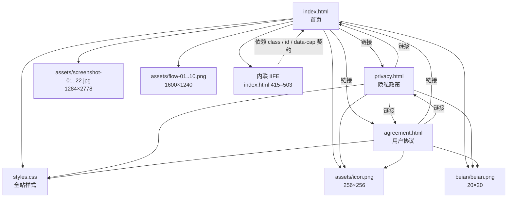
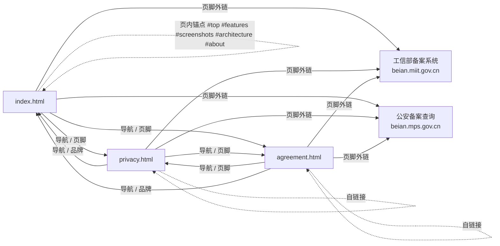

# 04 · 依赖关系

## 1. 依赖总览

| 依赖类型             |           数量 | 说明                                           |
| -------------------- | -------------: | ---------------------------------------------- |
| 第三方运行时依赖     |          **0** | 无 CDN、无远程字体、无 JS/CSS 库、无统计/广告  |
| 构建依赖             |          **0** | 无 `package.json`、无打包、无预处理器          |
| 服务端依赖           |          **0** | 无 API、无数据库、无 SSR                       |
| 站点运行所需本地文件 |             38 | 3 个 HTML + 1 个 CSS + 34 个资源               |
| 浏览器能力依赖       |       约 20 项 | 现代 CSS 布局、Web API（见第 6 节）            |
| 交付依赖             | Git + 静态托管 | GitHub 远程仓库、GitHub Pages、自定义域、HTTPS |

**依赖原则**：能用平台原生能力解决，就不引入库；能本地自托管，就不引用远程资源。这使得站点没有安装步骤、没有版本升级、没有供应链风险，也不会向第三方泄露访客 IP/UA。

---

## 2. 文件级直接依赖

### 2.1 HTML 对资源的精确依赖

| 页面           | CSS                        |                              图标 |  截图 | 架构图 | 备案图 | 脚本 |
| -------------- | -------------------------- | --------------------------------: | ----: | -----: | -----: | ---- |
| index.html     | `styles.css?v=20261023-3`  | 4 次（favicon、页头、Hero、页脚） | 22 次 |  10 次 |   1 次 | 1 段 |
| privacy.html   | `styles.css`（无版本参数） |       3 次（favicon、页头、页脚） |     — |      — |   1 次 | —    |
| agreement.html | `styles.css`（无版本参数） |                              3 次 |     — |      — |   1 次 | —    |

> 图标在首页实际引用 4 次（`<link rel=icon>`、页头 `.brand img`、Hero、页脚 `.footer-brand img`），浏览器会复用同一缓存。

### 2.2 CSS 对资源的依赖

[styles.css](../../styles.css) 内部：

- 无 `@import`；
- 无 `url(...)`（没有任何背景图、字体文件或图片引用）；
- 无远程 `@font-face`，字体全部来自系统字体栈。

因此 CSS 可以独立加载，不存在样式层面的级联外部依赖。

---

## 3. 资源依赖矩阵

| 资源       | 具体文件                              | 规格          |      体积 | 引用方                                    | 替换影响                   |
| ---------- | ------------------------------------- | ------------- | --------: | ----------------------------------------- | -------------------------- |
| 品牌图标   | `assets/icon.png`                     | 256×256 PNG   |     39 KB | 三页 favicon / 页头 / 页脚；首页另有 Hero | 品牌视觉、浏览器标签       |
| 应用截图   | `assets/screenshot-01.jpg` … `22.jpg` | 1284×2778 JPG | 约 5.9 MB | 首页轮播舞台 + 缩略图                     | 首屏与轮播、说明文字需同步 |
| 平台架构图 | `assets/flow-01.png` … `flow-10.png`  | 1600×1240 PNG |    3.0 MB | 首页架构区 10 张卡片                      | 架构说明与 `FIG n/10` 编号 |
| 备案徽标   | `beian/beian.png`                     | 20×20 PNG     |      4 KB | 三页页脚公安备案链接                      | 合规展示                   |
| 分享压缩包 | `.trae-html-share-packages/*.zip`     | 3 个 ZIP      |  约 49 MB | **无**                                    | 仅仓库体积，不影响站点     |

**资源命名耦合**：

- 截图编号 `01`–`22` 被 HTML 的 `src` 直接引用，且顺序即展示顺序；文件名本身不含语义。
- 架构图编号 `01`–`10` 与 `FIG n/10` 的文案对应，但 JS 不读取编号。
- 图标与备案图路径固定，被三页重复引用。

---

## 4. 页面跳转依赖图

**内部链接约束**：

| 来源         | 链接形式                                                   | 解析结果     |
| ------------ | ---------------------------------------------------------- | ------------ |
| 首页页内     | `#top` `#features` `#screenshots` `#architecture` `#about` | 当前页锚点   |
| 文档页到首页 | `index.html#top` 等                                        | 首页对应锚点 |
| 文档页之间   | `privacy.html` / `agreement.html`                          | 同目录文件   |
| 品牌         | `index.html`                                               | 首页顶部     |

锚点目标全部存在于首页：`#top`（body）、`#intro`、`#features`、`#screenshots`、`#architecture`、`#system`、`#about`。注意 `#intro` 与 `#system` 未出现在导航中，但仍是有效锚点。

---

## 5. 外部依赖（仅用户主动触发）

| 外部地址                                                         | 位置                     | 用途                 | 打开方式 | 安全属性                    |
| ---------------------------------------------------------------- | ------------------------ | -------------------- | -------- | --------------------------- |
| `https://beian.miit.gov.cn/`                                     | 三页页脚                 | ICP 备案查询         | 新窗口   | `rel="noopener noreferrer"` |
| `https://beian.mps.gov.cn/#/query/webSearch?code=14010602111139` | 三页页脚                 | 公安联网备案查询     | 新窗口   | 同上                        |
| `https://jl.43322.cn`                                            | 正文 / 页脚              | 官网域名，纯文本展示 | 不可点击 | —                           |
| `56967916@qq.com` / `uull@aliyun.com`                            | 关于我们 / 页脚 / 法律页 | 联系方式，纯文本     | 不可点击 | —                           |

**没有**：App Store 链接（页面写明「即将上架」）、社交媒体、统计脚本、字体 CDN、图片 CDN、客服 SDK。页面加载阶段的外部请求数为 **0**。

---

## 6. 浏览器能力依赖

| 能力                                        | 使用位置               | 不支持时的表现     | 备注                                                       |
| ------------------------------------------- | ---------------------- | ------------------ | ---------------------------------------------------------- |
| CSS 自定义属性                              | 全站令牌               | 颜色/圆角/阴影失效 | 现代浏览器均支持                                           |
| CSS Grid                                    | 各网格容器             | 卡片堆叠           | intro/sys/flow 在 960px 以下单列；features 到 640px 才单列 |
| Flexbox                                     | 导航、Hero、卡片、页脚 | 布局错位           | 基础能力                                                   |
| `aspect-ratio`                              | `.cvr-phone`           | 手机框高度异常     | 与截图画幅绑定                                             |
| `backdrop-filter`                           | 页头、箭头             | 毛玻璃变半透明底色 | 已带 `-webkit-` 前缀                                       |
| `background-clip: text`                     | Hero 渐变标题          | 标题不可见或纯色   | 已带 `-webkit-` 前缀；有 `color: transparent` 兜底风险     |
| `scroll-behavior: smooth`                   | 锚点跳转               | 直接跳转           | 减弱动效时关闭                                             |
| `scroll-margin-top`                         | `[id]`                 | 锚点被页头遮挡     | 一个基础值 + 两个断点覆盖（86/150/180px）                  |
| `object-fit` / `object-position`            | 截图舞台/缩略图        | 图片拉伸           | 舞台用 `cover` + `top center`                              |
| `prefers-reduced-motion`                    | 动效降级               | 动画照常           | 渐进增强                                                   |
| `loading="lazy"`                            | 截图、架构图           | 一次性加载全部图   | 首图显式 `fetchpriority="high"`                            |
| `decoding="async"`                          | 截图                   | 同步解码           | 性能提示                                                   |
| `fetchpriority`                             | 首张截图               | 忽略提示           | 仍可正常加载                                               |
| `classList.toggle`                          | 轮播                   | 脚本报错           | 基础 DOM API                                               |
| `Element.closest`                           | 缩略图委托             | 点击缩略图无效     | 现代浏览器支持                                             |
| `String.padStart`                           | 计数                   | 脚本报错           | ES2017                                                     |
| `scrollIntoView({behavior, block, inline})` | 缩略图定位             | 可能整页滚动       | 参数对象在旧 Safari 可能被忽略                             |
| Touch Events                                | 手势切换               | 只能点按钮         | `passive: true`                                            |
| `getBoundingClientRect`                     | 键盘可见性判断         | 键盘无效           | 基础 API                                                   |
| `Image` 预加载                              | 相邻图预取             | 切换稍慢           | 无回调，不阻塞                                             |

**目标环境**：桌面 Chrome/Safari/Edge/Firefox 与 iOS Safari 的近期版本。页面自身声明应用支持 iOS 26.0+，但官网未对旧浏览器做 polyfill 或降级提示。

---

## 7. 工具链与部署依赖

| 环节     | 依赖                          | 是否在仓库内声明 | 说明                                         |
| -------- | ----------------------------- | ---------------- | -------------------------------------------- |
| 本地预览 | Python 3 或 Node.js（二选一） | 否               | 任意静态服务器即可                           |
| 版本管理 | Git + GitHub 远程 `origin`    | `.git/`          | `https://github.com/kkkh/garden-website.git` |
| 发布     | GitHub Pages                  | 否（平台设置）   | 仓库内无 `CNAME`、无 Actions 工作流          |
| 域名     | `jl.43322.cn`                 | 否               | 需在域名服务商与 Pages 设置中配置            |
| HTTPS    | GitHub Pages 自动证书         | 否               | 平台能力                                     |
| 构建     | 无                            | —                | 推送 `main` 即发布源文件                     |

因为**没有构建步骤**，本地看到的文件与线上文件完全一致；不存在「本地正常、构建后异常」这一类问题，问题通常来自缓存或路径大小写。

---

## 8. 版本与内容耦合清单

这些内容不是代码依赖，但改一处必须同步另一处：

| 耦合项                       | 出现位置                                                            |             数量 |
| ---------------------------- | ------------------------------------------------------------------- | ---------------: |
| 截图总数「22」               | 首页第 153 行文案、第 202 行 `#cvrTotal`、本 Wiki、桌面缩略图 11 列 |             4 类 |
| 架构图总数「10」             | 第 217 行文案、10 个 `FIG n/10`、10 个文件                          |             3 类 |
| CSS 版本 `20261023-3`        | 仅首页 `<link>`                                                     | 1 处，文档页缺失 |
| 法律生效日期 `2026年9月25日` | 隐私政策、用户协议各第 34 行（每行 2 个日期）                       |             2 页 |
| ICP 备案号                   | 三页页脚各 1 处有效（另有 3 处旧版权注释）                          |         3 处有效 |
| 公安备案号                   | 三页页脚各 1 处有效（另有 3 处旧版权注释）                          |         3 处有效 |
| 联系邮箱                     | 三页共 6 处 `56967916@qq.com`，另 1 处 `uull@aliyun.com`            |             7 处 |
| 官网域名                     | 三页正文/页脚共 9 处有效（另有 3 处旧版权注释）                     |             9 处 |
| 品牌图标路径                 | 三页 favicon/页头/页脚 + 首页 Hero                                  |            10 次 |

---

## 9. 依赖风险与处置

| 风险             | 等级 | 说明                               | 处置建议                                                  |
| ---------------- | ---- | ---------------------------------- | --------------------------------------------------------- |
| 资源 404         | 高   | 路径大小写、目录被移动、文件名改名 | 保持 `assets/`、`beian/` 结构与大小写；发布前用服务器验证 |
| CSS 缓存不一致   | 中   | 文档页未带版本号                   | 改样式后同步给两个文档页加 `?v=`，或统一版本策略          |
| 图片缓存不更新   | 中   | 同名覆盖后 CDN 仍返回旧图          | 换文件名并更新 `src`，或强制刷新验证                      |
| 数量文案不一致   | 中   | 增删截图/架构图后文案未改          | 按第 8 节清单逐项核对                                     |
| 三页公共部分漂移 | 中   | 页头/页脚复制维护                  | 改动时三页同时改，按维护清单复核                          |
| 仓库体积         | 低   | `assets/` 8.9 MB + ZIP 49 MB       | 分享包移出版本库或历史；图片转 WebP                       |
| 浏览器兼容       | 低   | 依赖现代 CSS/JS                    | 目标用户以现代移动端为主；如需兼容旧机，增加降级          |
| 外链失效         | 低   | 备案系统域名或查询参数变化         | 上线前人工点验                                            |
| 无自动化测试     | 低   | 回归靠人工                         | 使用 [05](05-run-and-deploy.md) 的验收清单                |

**依赖变更检查顺序**：先确认资源路径 → 再确认 HTML 引用 → 再确认 CSS 契约 → 最后确认文案数量与三页一致性。
